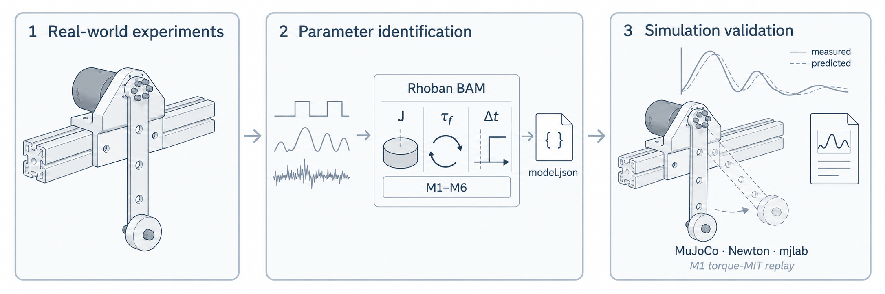

<h1 align="center">MotorFit</h1>

<p align="center">
  <strong>Record a motor. Identify its dynamics. Validate the model.</strong>
</p>

<p align="center">
  <a href="pyproject.toml"></a>
  <a href="docs/environments.md"></a>
  <a href="LICENSE"></a>
  <a href="docs/acquisition.md"></a>
</p>

<p align="center">
  <a href="#quickstart">Quickstart</a> ·
  <a href="#supported-motors">Supported motors</a> ·
  <a href="docs/README.md">Documentation</a> ·
  <a href="README.zh-CN.md">简体中文</a>
</p>

MotorFit extends [Rhoban BAM](https://github.com/Rhoban/bam) with native motor drivers, bench-data acquisition and model validation. Collect commands and measured motion, identify actuator dynamics, and compare model predictions with recordings and supported physics backends.

<p align="center">
  <a href="docs/images/overview.png">
    
  </a>
</p>

## Highlights

- **Record with native drivers.** Five motor families, raw CAN frames, timestamped feedback and a saved experiment configuration.
- **Identify with BAM.** M1–M6 friction models, parameter fitting, evaluation on held-out recordings and reloadable model snapshots.
- **Validate against motion.** Compare measurements with model predictions, then replay supported M1 models in MuJoCo, Newton or mjlab.

## Quickstart

Requires **Python 3.12** and [uv](https://docs.astral.sh/uv/getting-started/installation/). Start with the bundled offline example; no motor or GPU is needed.

```bash
git clone --recurse-submodules git@github.com:han-xudong/motorfit.git
cd motorfit
git config core.hooksPath .githooks
uv sync --frozen
uv run --frozen motorfit demo \
  --dataset examples/offline/manifest.json --output outputs/demo
```

This checks three complete recordings against a frozen model and writes a comparison plot, metrics and predicted trajectories to `outputs/demo/`. The repository is private; cloning requires access. MotorFit is unreleased at version 0.1.0.

<details>
<summary><strong>Try processing and fitting the example data</strong></summary>

```bash
uv run --frozen motorfit process \
  --raw examples/offline/raw --out outputs/processed --dt 0.01
uv run --frozen motorfit fit \
  --logdir outputs/processed --model m1 --trials 20 --output outputs/demo-fit.json
```

This small fit demonstrates the API. It does not reproduce the formal study's model selection. See the [identification guide](docs/bam-identification.md) for training, validation and evaluation.

</details>

<details>
<summary><strong>Replay the example in MuJoCo</strong></summary>

```bash
uv sync --frozen --extra simulation
uv run --frozen --extra simulation motorfit replay \
  --dataset examples/offline/manifest.json --engine mujoco \
  --dt 0.002 --output outputs/mujoco
```

See [optional environments](docs/environments.md) for Newton and mjlab, and [validation](docs/validation.md) for supported models and replay settings.

</details>

## Supported motors

| Family | Integration |
| :--- | :--- |
| [RobStride](configs/motors/robstride) | RS00–RS06 · onboard MIT control |
| [Damiao](configs/motors/damiao) | 16 MIT profiles, including DM4310, DM4340 and DM8009 |
| [MyActuator](configs/motors/myactuator) | RMD-X V3 · current commands with host PD |
| [HighTorque](configs/motors/hightorque) | ht_can · torque commands with host PD |
| [Hexfellow](configs/motors/hexfellow) | CANopen 07 / 08 · CAN-FD torque commands with host PD |

## Documentation

- **[Record your motor](docs/your-motor.md)** — select a profile, measure the fixture, configure the device and [collect data](docs/acquisition.md).
- **[Identify and evaluate](docs/workflow.md)** — prepare recordings, fit candidate models and evaluate them on separate data.
- **[Reproduce the RS05 study](docs/case-studies/rs05.md)** — 111 recordings, three loads and three physics backends. Git includes a three-record example; the full dataset and videos are [stored separately](docs/case-studies/rs05.md#what-to-reproduce).
- **[Extend MotorFit](docs/architecture.md)** — understand the driver, controller, fixture and dataset interfaces.

See the [documentation index](docs/README.md) for all guides and the [repository policy](docs/repository.md) for file placement and Git tracking.

## Coding agents

Open this checkout in Codex or Claude Code and ask for the task you need. The repository includes four shared [skills](.agents/skills):

| Skill | Task |
| :--- | :--- |
| [motorfit-setup](.agents/skills/motorfit-setup/SKILL.md) | Install dependencies and run the offline example |
| [motorfit-record](.agents/skills/motorfit-record/SKILL.md) | Configure a mounted motor and collect bench data |
| [motorfit-identify](.agents/skills/motorfit-identify/SKILL.md) | Process recordings, fit candidates and select a model |
| [motorfit-validate](.agents/skills/motorfit-validate/SKILL.md) | Evaluate a fixed model and run supported physics replay |

For example, ask “Use motorfit-setup to install MotorFit and run the offline example.” The skill sources live in `.agents/skills/`, where Codex discovers them directly. Claude Code reads the same files through the `.claude/skills` relative symlink; other agents can read the source directory directly.

## Acknowledgements

We thank the authors of [Rhoban BAM](https://github.com/Rhoban/bam) for the actuator models and parameter identification tools used in MotorFit.

## License

MotorFit is licensed under the [Apache License 2.0](LICENSE).
