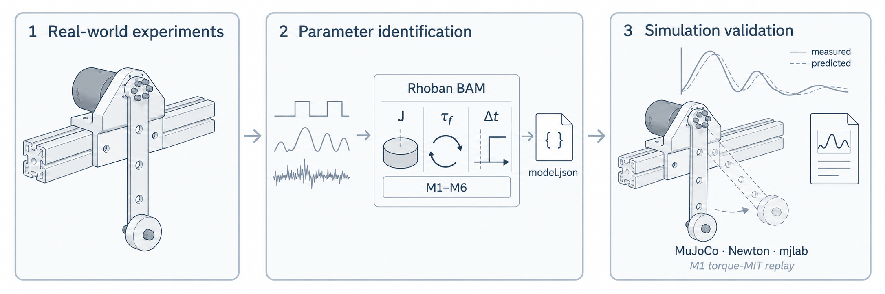

<h1 align="center">MotorFit</h1>

<p align="center">
  <strong>采集电机运动，辨识动力学参数，验证模型表现。</strong>
</p>

<p align="center">
  <a href="pyproject.toml"></a>
  <a href="docs/environments.md"></a>
  <a href="LICENSE"></a>
  <a href="docs/acquisition.md"></a>
</p>

<p align="center">
  <a href="#快速开始">快速开始</a> ·
  <a href="#支持的电机">支持的电机</a> ·
  <a href="https://motorfit.github.io/">文档</a> ·
  <a href="README.md">English</a>
</p>

MotorFit 在 [Rhoban BAM](https://github.com/Rhoban/bam) 基础上补充独立电机驱动、台架数据采集与模型验证。记录指令和实测运动，辨识执行器动力学，再通过实测轨迹与受支持的物理仿真后端检验预测结果。

<p align="center">
  <a href="docs/images/overview.png">
    
  </a>
</p>

## 主要功能

- **独立驱动采集。** 支持五类电机，保存原始 CAN 帧、带时间戳的反馈和完整实验配置。
- **基于 BAM 辨识。** 使用 M1–M6 摩擦模型进行参数拟合、独立数据评估，以及模型快照保存与重载。
- **对照实测验证。** 比较模型预测与实测轨迹，并在 MuJoCo、Newton 或 mjlab 中回放受支持的 M1 模型。

## 快速开始

需要 **Python 3.12** 和 [uv](https://docs.astral.sh/uv/getting-started/installation/)。先运行仓库自带的离线示例，无需电机或 GPU。

```bash
git clone --recurse-submodules git@github.com:motorfit/motorfit.git
cd motorfit
uv sync --frozen
uv run --frozen motorfit demo \
  --dataset examples/offline/manifest.json --output outputs/demo
```

示例使用冻结模型检验三条完整记录，将对照图、误差指标和预测轨迹写入 `outputs/demo/`。当前仓库为私有，克隆需要访问权限。MotorFit 尚未发布，版本保持为 0.1.0。

<details>
<summary><strong>尝试数据处理与小规模拟合</strong></summary>

```bash
uv run --frozen motorfit process \
  --raw examples/offline/raw --out outputs/processed --dt 0.01
uv run --frozen motorfit fit \
  --logdir outputs/processed --model m1 --trials 20 --output outputs/demo-fit.json
```

这个小规模拟合用于演示接口，不复现正式实验的模型选型。训练、验证与评估流程见[辨识指南](docs/bam-identification.md)。

</details>

<details>
<summary><strong>在 MuJoCo 中回放示例</strong></summary>

```bash
uv sync --frozen --extra simulation
uv run --frozen --extra simulation motorfit replay \
  --dataset examples/offline/manifest.json --engine mujoco \
  --dt 0.002 --output outputs/mujoco
```

Newton 与 mjlab 的安装见[可选环境](docs/environments.md)，支持的模型和回放设置见[验证指南](docs/validation.md)。

</details>

## 支持的电机

| 系列 | 接入方式 |
| :--- | :--- |
| [RobStride](configs/motors/robstride) | RS00–RS06 · 电机端 MIT 控制 |
| [达妙 Damiao](configs/motors/damiao) | 16 个 MIT 型号配置，含 DM4310、DM4340 和 DM8009 |
| [MyActuator](configs/motors/myactuator) | RMD-X V3 · 电流指令与上位机 PD |
| [HighTorque](configs/motors/hightorque) | ht_can · 力矩指令与上位机 PD |
| [Hexfellow](configs/motors/hexfellow) | CANopen 07 / 08 · CAN-FD 力矩指令与上位机 PD |

## 文档

- **[采集自己的电机](docs/your-motor.md)** — 选择型号、测量夹具、配置设备并[采集数据](docs/acquisition.md)。
- **[辨识与评估](docs/workflow.md)** — 整理记录、拟合候选模型，在独立数据上评估。
- **[复现 RS05 实验](docs/case-studies/rs05.md)** — 111 条记录、三档负载、三个物理仿真后端。Git 包含三条完整示例，全部数据与视频[单独保存](docs/case-studies/rs05.md#what-to-reproduce)。
- **[扩展 MotorFit](docs/architecture.md)** — 了解驱动、控制器、夹具和数据集接口。

全部指南见[文档索引](docs/index.md)；文件存放与 Git 跟踪规则见[仓库规范](docs/repository.md)。

## Coding agent 使用

在 Codex 或 Claude Code 中打开本仓库，直接描述要完成的任务。仓库提供四个共享 [skills](.agents/skills)：

| Skill | 任务 |
| :--- | :--- |
| [motorfit-setup](.agents/skills/motorfit-setup/SKILL.md) | 安装依赖并跑通离线示例 |
| [motorfit-record](.agents/skills/motorfit-record/SKILL.md) | 配置已安装的电机并采集台架数据 |
| [motorfit-identify](.agents/skills/motorfit-identify/SKILL.md) | 处理记录、拟合候选模型并选型 |
| [motorfit-validate](.agents/skills/motorfit-validate/SKILL.md) | 评估固定模型并运行受支持的物理回放 |

例如：“使用 motorfit-setup 安装 MotorFit，并跑通离线示例。”技能正文直接存放在 `.agents/skills/`，由 Codex 自动发现；Claude Code 通过 `.claude/skills` 相对软链接读取同一份文件，其他 agent 也可直接读取正文目录。

## 致谢

感谢 [Rhoban BAM](https://github.com/Rhoban/bam) 的作者提供本项目使用的执行器模型与参数辨识工具。

## 许可证

MotorFit 采用 [Apache License 2.0](LICENSE) 许可证。
