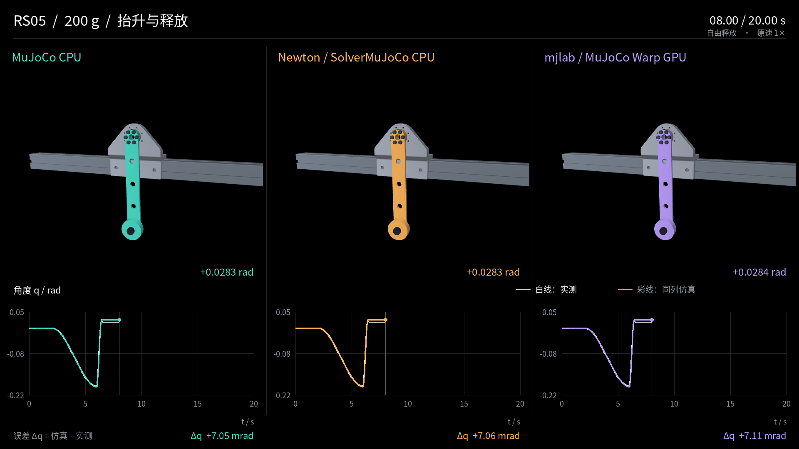

# RS05 identification study

This study applies MotorFit's workflow to one RobStride RS05 and a measured
pendulum. It provides the real recordings used by the offline example and shows
both the accuracy and remaining limitations of the selected M1 model.



## Experiment

| Item | Recorded configuration |
|---|---|
| Motor | RobStride RS05, UID `542b38001c443916` |
| Loads | 100, 200 and 500 g weights, plus their measured fasteners |
| Lever radius | 0.2 m |
| Recordings | 37 per load; 111 total |
| Original samples | 227,511 |
| Collection | Vendor RS05 C++ interface with a SocketCAN caller and independent wire capture |
| Identification | BAM M1–M6 comparison; M1 selected under the recorded protocol |

The physical tip masses differ from the weight labels because bolts and nuts move
with the load. [Fixture](rs05-fixture.md) records those masses and inertia values.

The fixed split contains 32 training, 16 gain-validation, 24 load-validation,
36 final-test and 3 long-test recordings. The gain schedule was:

| Weight | Kd at Kp=10 | Kd at Kp=20 | Kd at Kp=30 |
|---|---:|---:|---:|
| 100 g | 0.5 | 0.6 | 0.8 |
| 200 g | 0.6 | 0.8 | 1.0 |
| 500 g | 0.9 | 1.2 | 1.5 |

These are settings for this measured assembly. Earlier 200 g runs with
Kp=30/Kd=0.5 showed persistent oscillation and are excluded from the formal dataset.
The completed 100 g run 15 retains a documented wrapper-finalization interruption
and its verification evidence.

## Selected model

The frozen M1 snapshot shipped with the example contains:

| Parameter | Value |
|---|---:|
| `torque_ratio` | 1.163923 |
| `armature` | 0.000236315 kg·m² |
| `q_offset` | −0.00121425 rad |
| `command_delay` | 0.00629308 s |
| `friction_base` | 0.0430022 N·m |
| `friction_viscous` | 0.00298792 N·m·s/rad |

The [parameter reference](../reference/parameters.md) explains their meaning.
These values belong to this motor, fixture and experiment. They are not model-wide
RS05 constants. Full-precision values are in
[`tests/fixtures/offline/model.json`](https://github.com/motorfit/motorfit/blob/main/tests/fixtures/offline/model.json).

## RS05 reference acquisition

The historical collector used staged motion schedules at 100 Hz:

| Motion | Schedule | Duration |
|---|---|---:|
| Sweep, combined sinusoids, up/down | 2 s hold + 12 s excitation + 4 s return + 2 s hold | 20 s |
| Lift and release | 2 s hold + 4 s lift + 14 s disabled observation | 20 s |
| Long sweep | 2 s hold + 30 s excitation + 4 s return + 2 s hold | 38 s |

Nominal endpoints were included, producing 2,001 or 3,801 raw timestamps. The
current Python recorder uses the [trajectory scaling](../reference/trajectories.md)
in its own implementation; setting a duration of 20 seconds does not reproduce
the historical staged schedule.

## Results

On the 36 final-test records, frozen BAM M1 has mean position MAE of approximately
**2.035 mrad**. The later MuJoCo 3.17/MJWarp comparison gives about **2.220 mrad**
with its original friction settings. Those averages coexist with a visible release
and stopping error in the 200 g case. [Results](rs05-findings.md) separates the
aggregate accuracy, cross-engine agreement and unresolved behavior.

## What to reproduce

The repository includes three complete recordings, the selected model and saved
BAM predictions. [Quickstart](../getting-started/quickstart.md) reproduces this
self-contained subset without the research archive.

The full dataset, CAD, extended comparisons and videos are kept in a separate
local archive. They are **not downloaded by cloning the repository**:

```text
data/rs05/
  formal-v3/       # 111 recordings, captures and manifest
  models/         # candidates and model-selection records
  results/        # predictions, comparisons, diagnostics and videos
  assets/bench/   # CAD, meshes and measured mass properties
  scenes/release/ # release-event scenes
  environments/  # runtime inventories and source revisions
```

When that archive is available, verify its manifest before using it:

```bash
uv run --no-sync motorfit verify --dataset data/rs05/formal-v3/manifest.json
```

The archive's `results/README.md` indexes the complete evidence. Model-selection
records are under `models/provenance/` and `results/identification/`.

## Advanced validation

The following operations require the full archive. They are not part of the
three-record quickstart.

### Replay the CAD fixture

```bash
uv sync --frozen --extra simulation
uv run --no-sync motorfit replay \
  --dataset data/rs05/formal-v3/manifest.json --engine mujoco --dt 0.002 \
  --scene-assets data/rs05/assets/bench --output outputs/rs05-cad
```

The default CAD fixture includes the finite-body inertias. Add
`--fixture-model identified_point` to keep the fitting model's inertia while
retaining CAD appearance. Without `--scene-assets`, replay uses the equivalent
pendulum model. These choices must be distinguished in reported results.

A solver comparison can additionally specify
`--options configs/simulation/asroballet-option.xml` and `--friction original`
or `--friction default`. The option file replaces scene solver options; it does
not edit a robot model. `--ablations` evaluates parameter removals on the training
split. [Backends](../reference/backends.md) describes runtime requirements.

### Audit feedback and release timing

```bash
uv run --no-sync motorfit audit-feedback \
  --dataset data/rs05/formal-v3/manifest.json --output outputs/rs05-audit
uv run --no-sync motorfit release-replay \
  --dataset data/rs05/formal-v3/manifest.json \
  --scenes data/rs05/scenes/release --output outputs/rs05-release
```

Release replay runs the 27 release records with a C++ helper at a default
62.5 μs timestep. It compares the processed enable transition with STOP-send and
acknowledgment times while keeping the model fixed. These are alternative event
timing assumptions; none directly measures current decay in the power stage.

`export-formal` reconstructs BAM JSON from the original CSV/wire captures. It
requires `--record`, `--metadata` and `--output`; use the metadata belonging to the
same capture. New native recordings already have BAM-format `raw.json` files.

### Render saved trajectories

```bash
MUJOCO_GL=egl uv run --no-sync python scripts/render_replay.py \
  --dataset data/rs05/formal-v3/manifest.json \
  --source data/rs05/results/replay/cad-baseline \
  --assets data/rs05/assets/bench --output outputs/rs05-video \
  --grams 200 --trajectory lift_and_drop --preview 8
```

Omit `--preview` to render the complete recording. The renderer uses saved states
and a common camera; it does not run new physics. ffmpeg and a working graphics
runtime are required.

## Complete replay videos

The archive includes full compilations under `results/media/`:

| File | Duration |
|---|---:|
| `rs05_100g_all_profiles_complete.mp4` | 118.000 s |
| `rs05_200g_all_profiles_complete.mp4` | 118.033 s |
| `rs05_500g_all_profiles_complete.mp4` | 118.000 s |

Each combines four ordinary clips and one long sweep at original speed. The panels
show saved MuJoCo, Newton and mjlab CAD-baseline states, with the measured position
as reference. They predate the later release-timing study.

## How replay duration is calculated

Display duration is `sample_count × dt`, rounded up to a whole frame at 30 fps.
The last sample is held for its final display interval. Ordinary clips have 2,000
processed samples at 0.01 s. The long 200 g clip has 3,801 processed samples and
therefore 1,141 video frames; the other long clips have 3,800 samples and 1,140 frames.
This accounts for the 0.033 s difference between compilations.
