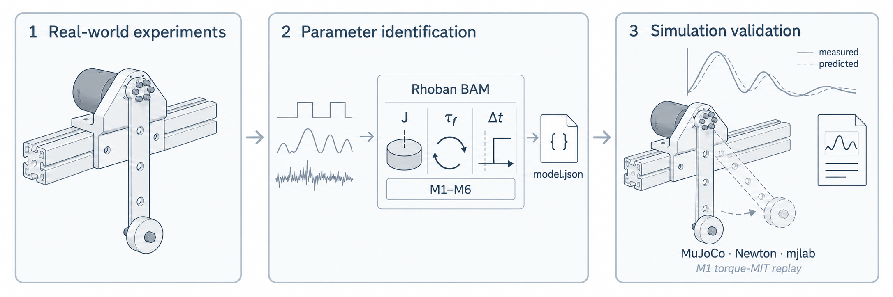

# MotorFit

**Record a motor. Identify its dynamics. Validate the model.**

MotorFit adds motor drivers, experiment recording and simulation validation to
[Rhoban BAM](https://github.com/Rhoban/bam). Start with a complete offline run,
then use the same tools with a measured motor and fixture.



## Start here

- [Quickstart](getting-started/quickstart.md): install MotorFit and replay three recordings without hardware.
- [Workflow](getting-started/workflow.md): plan a study, fit candidates and evaluate a fixed model.
- [Configuration](guide/configuration.md): select a motor profile and describe the mounted assembly.

## Find a guide

| You want to… | Read |
|---|---|
| Record motor commands and feedback | [Recording](guide/acquisition.md) |
| Fit a model to your measurements | [Identification](guide/identification.md) |
| Compare predictions with recordings | [Validation](guide/validation.md) |
| Check supported devices and runtimes | [Motor support](reference/motors.md) · [Backends](reference/backends.md) |
| Inspect a completed experiment | [RS05 study](case-studies/rs05.md) |
| Add a driver or change the project | [Architecture](development/architecture.md) · [Contributing](development/contributing.md) |

The current version is **0.1.0**. The handbook is public; cloning the source
repository requires access. A [Chinese introduction](https://github.com/motorfit/motorfit/blob/main/README.zh-CN.md)
is available in the repository.

```{toctree}
:hidden:
:caption: Getting started

Quickstart <getting-started/quickstart>
Workflow <getting-started/workflow>
```

```{toctree}
:hidden:
:caption: User guide

Configuration <guide/configuration>
Recording <guide/acquisition>
Effort control <guide/effort-control>
Identification <guide/identification>
Validation <guide/validation>
```

```{toctree}
:hidden:
:caption: Reference

Motor support <reference/motors>
Trajectories <reference/trajectories>
Backends <reference/backends>
Protocols <reference/protocols>
```

```{toctree}
:hidden:
:caption: RS05 study

Experiment <case-studies/rs05>
Fixture <case-studies/rs05-fixture>
Findings <case-studies/rs05-findings>
```

```{toctree}
:hidden:
:caption: Development

Architecture <development/architecture>
Contributing <development/contributing>
```
