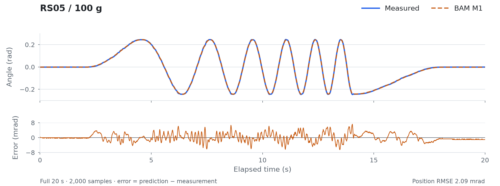

# Offline example

This is the first-use example for [MotorFit](../../README.md). It uses the [RS05 reference study](../../docs/case-studies/rs05.md) to exercise the workflow without hardware.

Three complete real recordings and their frozen `model.json` are included, one recording per load. Their original split labels, raw/processed JSON, SHA-256 and BAM reference trajectories are preserved. This directory contains every dataset input needed by the example and can be copied on its own. It is a small installation/use example, not a replacement training or validation dataset.

```bash
uv sync --frozen
uv run motorfit demo --dataset examples/offline/manifest.json --output outputs/demo
```

The example checks inputs, loads frozen M1, reruns upstream BAM with no periodic state reset, checks agreement with saved predictions, and produces a plot/CSV/JSON/NPZ. It does not import or open a hardware connection. Works from a copied checkout too; when running outside the repository pass absolute paths to this manifest and the output.

To demonstrate resampling and a small fit:

```bash
uv run motorfit process --raw examples/offline/raw --out outputs/processed --dt 0.01
uv run motorfit fit --logdir outputs/processed --model m1 --trials 20 --output outputs/demo-fit.json
```

This 20-trial fit only demonstrates the API. It does not reproduce formal parameter selection or provide another independent final-test result. The frozen model is untouched.

## Measured motion and model prediction

The figure below shows the complete 100 g `sin_time_square` recording from this example's gain-validation split, with the frozen BAM M1 prediction and its position residual. This run was chosen to show a frequency sweep, not by selecting the smallest error. The full three-record comparison remains the output of `motorfit demo`.

<picture>
  <source media="(prefers-color-scheme: dark)" srcset="../../docs/images/identification-dark.png">
  
</picture>

Regenerate both theme variants from the checked dataset and model references:

```bash
uv run --frozen python scripts/render_readme_figure.py
uv run --frozen python scripts/render_readme_figure.py --theme dark
```
